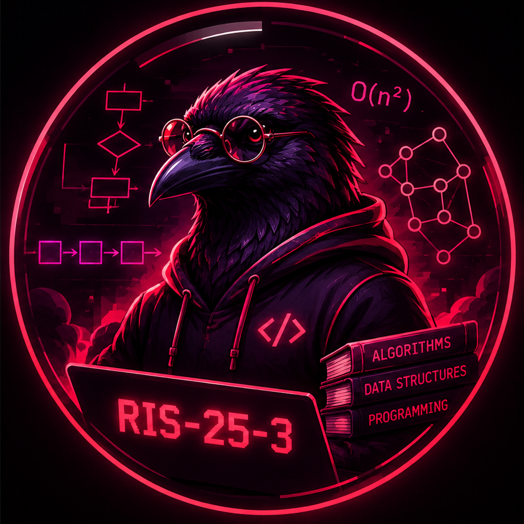

  

# Добро пожаловать на семинары курса «Алгоритмы и структуры данных», 2026/2027 👋

Занятия для студентов 2 курса Пермского кампуса НИУ ВШЭ.

## Как попасть в организацию

1. Зарегистрироваться на [GitHub](https://github.com).
2. Отправить преподавателю логин учётной записи — вас добавят в организацию.
3. **Принять приглашение** в почте или на GitHub: репозитории публичные, клонировать можно сразу, но без членства в организации нельзя выполнять задания.
4. Настроить рабочее место и клонировать репозитории по инструкции [Установка необходимого ПО](https://github.com/algos-ris-25-3/docs/blob/main/%D0%A3%D1%81%D1%82%D0%B0%D0%BD%D0%BE%D0%B2%D0%BA%D0%B0%20%D0%BD%D0%B5%D0%BE%D0%B1%D1%85%D0%BE%D0%B4%D0%B8%D0%BC%D0%BE%D0%B3%D0%BE%20%D0%9F%D0%9E.md).

## Репозитории

- [code-tasks](https://github.com/algos-ris-25-3/code-tasks) — программные задания, **Python 3.14**, [VS Code](https://code.visualstudio.com/). Pull request в ветку `main-task-*`, после ревью **не вливают**.
- [manual-tasks](https://github.com/algos-ris-25-3/manual-tasks) — ручные задания, оформление в Markdown. Окружение Python не нужно. Pull request в `main`, после ревью **вливают**.
- [docs](https://github.com/algos-ris-25-3/docs) — инструкции: установка ПО, сдача кода, схема ветвления.

Список заданий — в проекте [Алгоритмы и структуры данных 26/27](https://github.com/orgs/algos-ris-25-3/projects/2). Правила веток и pull request в двух репозиториях с заданиями **разные**; подробности — в README каждого из них и в [схеме ветвления](https://github.com/algos-ris-25-3/docs/blob/main/%D0%9E%D0%BF%D0%B8%D1%81%D0%B0%D0%BD%D0%B8%D0%B5%20%D1%81%D1%82%D1%80%D1%83%D0%BA%D1%82%D1%83%D1%80%D1%8B%20%D0%B2%D0%B5%D1%82%D0%B2%D0%BB%D0%B5%D0%BD%D0%B8%D1%8F%20%D1%80%D1%83%D1%87%D0%BD%D1%8B%D1%85%20%D0%B8%20%D0%BF%D1%80%D0%BE%D0%B3%D1%80%D0%B0%D0%BC%D0%BC%D0%BD%D1%8B%D1%85%20%D0%B7%D0%B0%D0%B4%D0%B0%D1%87.md).
